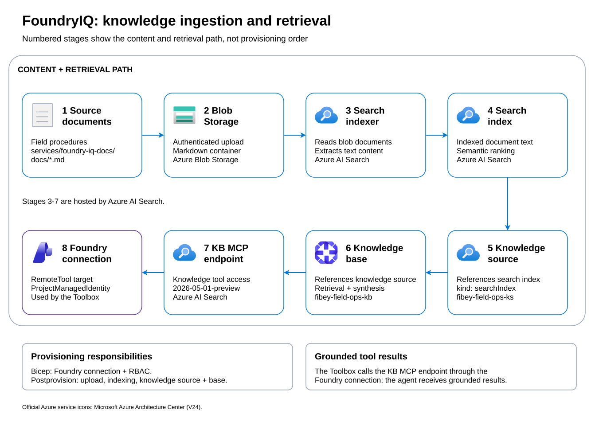

# Deployment

## Overview

Fibey Field Ops supports two agent modes:

1. **Foundry Hosted Mode** (deployed demo) - Uses Foundry's managed agent hosting
2. **Local Development Mode** - Runs the agent in-process with the gateway

This guide deploys the agent to **Foundry hosted agents** and the UI, gateway,
and operational backend services to **Azure Container Apps** using `azd`.

## Architecture

The deployment creates all resources in a single resource group (`rg-<env-name>`):

| Component | Azure Service | Source | Purpose |
|-----------|---------------|--------|---------|
| Chat UI | Container App | `ui/` | React frontend with activity sidebar |
| Gateway | Container App | `src/fibey/gateway/` | FastAPI proxy (hosted mode in the deployed demo) |
| Hosted agent | Foundry hosted agent | `src/fibey/agent/hosted.py` | Field operations agent + Toolbox MCP |
| Work Orders API | Container App | `services/work-orders-api/` | Work order CRUD backend |
| Inventory MCP | Container App | `services/inventory-mcp/` | Inventory MCP server |
| Status Dashboard | Container App | `services/status-dashboard/` | Network/service status page |
| AI Foundry account + project | Microsoft Foundry | `infra/core/ai/` | Hosts the model deployment, hosted agent, and toolbox |
| Model deployment | Foundry | `azure.yaml` | `gpt-4.1-mini` (configurable) |
| Foundry Toolbox + skills | Foundry (postdeploy) | `scripts/setup-toolbox.sh` | Single MCP endpoint for backend tools and skill resources |
| AI Search | Azure AI Search | `services/foundry-iq-docs/` | Knowledge base index + KB MCP endpoint |
| Container Registry | ACR | — | Docker image storage (apps + hosted agent) |
| Storage Account | Blob Storage | `services/foundry-iq-docs/` | Document storage |
| Log Analytics / App Insights | Workspace | — | Logging and monitoring |

## Prerequisites

- Azure subscription with Owner or Contributor + RBAC Admin roles
- Azure CLI (`az`) and Azure Developer CLI (`azd`)
- The azd AI agents extension: `azd extension install azure.ai.agents`
- Docker Desktop (for local image builds if needed)

## Quick Deployment

```bash
# 1. Clone repository
git clone https://github.com/Azure-Samples/fibey.git
cd fibey

# 2. Login
az login
azd auth login

# 3. Deploy everything
azd up
```

`azd up` performs the full deployment:

1. **Provision** — creates the resource group, AI Foundry account + project,
   model deployment, AI Search, storage, ACR, Container Apps environment, all
   five container apps, the Foundry knowledge-base connection, and all RBAC
   assignments (Bicep in `infra/`).
2. **Postprovision hook** — uploads FoundryIQ docs, builds the search index,
   and creates the knowledge source/base (`scripts/setup-knowledge-base.sh`).
3. **Deploy** — builds and pushes container images for all apps and deploys
   the hosted agent to the Foundry project.
4. **Postdeploy hook** — publishes the five skills from `skills/`, creates or
   updates the Foundry Toolbox with tool search and skill references, and
   promotes new versions to default (`scripts/setup-toolbox.sh`).

The gateway is provisioned with `AGENT_MODE=hosted`, the Foundry project
endpoint, and `HOSTED_AGENT_NAME=fibey-agent`. It calls the agent's streaming
Responses endpoint; the agent connects to the Toolbox for tools and skills.
Toolbox publication happens after service deployment because it needs the
Work Orders OpenAPI endpoint. If the agent starts before the Toolbox exists,
initialization can fail; finish the hook and redeploy the agent.

The end-to-end run recorded in [#36](https://github.com/Azure-Samples/fibey/issues/36)
completed `azd up` against an existing environment and verified hosted chat,
multi-turn continuity, and toolbox-sourced field-briefing activity in the UI.
A fresh resource-group deployment was attempted in
[#42](https://github.com/Azure-Samples/fibey/issues/42) and stopped during
provisioning on an overlong Container App name. A complete successful fresh
deployment has **not** yet been verified.

**Important:** Do NOT include `?api-version=v1` in the `TOOLBOX_MCP_URL`. The agent code automatically appends this.

Container App names retain `<environment>-<service>` when they satisfy Azure's
naming rules, including the 32-character limit. Otherwise, they use
`fibey-<eight-character-resource-token>-<service>`. Existing valid names are
unchanged. Other Azure resources retain their own environment-name constraints.
Use `azd show -e <environment>` to find the actual resource names and endpoints
rather than constructing them.

Run the read-only Container App naming regression against an authorized test
resource group:

```bash
FIBEY_INFRA_TEST_RESOURCE_GROUP=rg-<test-environment> \
  uv run --no-sync python -m unittest discover -s tests -p test_infra_names.py
```

This checks resolved ARM what-if names; preview/template validation alone can
miss nested resource-provider naming constraints.

## Environment variables

Provisioned endpoints are produced as Bicep outputs and stored in the azd
environment automatically. Useful configuration values:

| Variable | Default | Description |
|----------|---------|-------------|
| `FOUNDRY_MODEL` | `gpt-4.1-mini` | Model deployment name |
| `FOUNDRY_MODEL_CAPACITY` | `100` | Model deployment capacity (TPM, in thousands). Preserved across `azd up` runs |
| `TOOLBOX_NAME` | `fibey-toolbox` | Foundry Toolbox name |
| `KB_NAME` | `fibey-field-ops-kb` | Knowledge base name |
| `AZURE_SEARCH_INDEX` | `foundry-iq-docs-index` | Search index name |
| `AZURE_AI_PROJECT_NAME` | `fibey-project` | Foundry project name |
| `AZURE_AI_DEPLOYMENTS_LOCATION` | primary location | Region for the Foundry account/models |
| `IGNORE_STORAGE_SECURITY_CONTROL` | `false` | Opt-in `SecurityControl: Ignore` storage tag; use only with explicit approval for a demo environment |

The hosted model is selected by `AZURE_AI_MODEL_DEPLOYMENT_NAME` in `agent.yaml`
(`gpt-4.1-mini`), with deployment configuration in `azure.yaml`. Changing
`FOUNDRY_MODEL` alone does not change that selection; keep these files aligned
when choosing a different model.

## FoundryIQ Knowledge Base Setup



[Editable Excalidraw source](images/knowledge-pipeline.excalidraw)
(open in [Excalidraw](https://aka.ms/excalidraw)).

Follow the numbered arrows for the content and retrieval path: Markdown in
`services/foundry-iq-docs/docs/` is uploaded to Blob Storage and ingested by an
AI Search indexer. The resulting index backs a knowledge source and knowledge
base. The Toolbox accesses the KB MCP endpoint through a Foundry connection.
This is not provisioning order: Bicep creates the connection before the
postprovision hook builds the knowledge source and base.

This pipeline is configured **automatically** by the azd postprovision hook
(`azure.yaml` → `scripts/setup-knowledge-base.sh`):

1. **Documents uploaded to blob storage** from `services/foundry-iq-docs/docs/`.
2. **Search index and indexer created** — blob data source, `foundry-iq-docs-index`,
   semantic configuration `default`, and the indexer that ingests the markdown files.
3. **Knowledge Source created** — `fibey-field-ops-ks` (`kind: searchIndex`,
   `api-version=2026-05-01-preview`) pointing at `foundry-iq-docs-index`.
4. **Knowledge Base created** — `fibey-field-ops-kb`, referencing `fibey-field-ops-ks`.
5. **Foundry connection** — `kb-fibey-field-ops-kb` is created by Bicep
   (`RemoteTool` + `ProjectManagedIdentity`, target = KB MCP endpoint).
6. **RBAC** — Bicep grants the Foundry project and account managed identities
   `Search Index Data Reader` on the search service.

To re-run manually: `./scripts/setup-knowledge-base.sh` (requires an azd environment).

### Deployed components

| Layer | Name | Resource Group / Scope | Notes |
|-------|------|-------------------------|-------|
| Search service | `<env>-search` | `<resource-group>` | Azure AI Search, Basic SKU |
| Search index | `foundry-iq-docs-index` | Search service | 8 text documents, semantic ranking only, no vectors |
| Semantic config | `default` | `foundry-iq-docs-index` | `titleField=metadata_storage_name`, `contentField=content` |
| Knowledge source | `fibey-field-ops-ks` | AI Search REST API | `kind: searchIndex` via `2026-05-01-preview` |
| Knowledge base | `fibey-field-ops-kb` | AI Search REST API | References `fibey-field-ops-ks` |
| MCP endpoint | `https://<search-service>.search.windows.net/knowledgebases/fibey-field-ops-kb/mcp?api-version=2026-05-01-preview` | AI Search | Exposed by the knowledge base |
| Foundry connection | `kb-fibey-field-ops-kb` | AI Services account | `RemoteTool` + `ProjectManagedIdentity` |
| RBAC | `Search Index Data Reader` | AI Services managed identity | Required on the search service |

The knowledge base retrieval was validated with semantic `intents` requests against `fibey-field-ops-ks`, returning references and source data:

```json
{
  "intents": [{"search": "How do I splice a fiber optic cable?", "type": "semantic"}],
  "knowledgeSourceParams": [{"knowledgeSourceName": "fibey-field-ops-ks", "kind": "searchIndex", "includeReferences": true, "includeReferenceSourceData": true}]
}
```

> **Preview:** The knowledge source, knowledge base, and KB MCP endpoint use
> `2026-05-01-preview` for query planning and answer synthesis.
>
> **Note:** Azure AI Foundry workspaces currently allow up to **120 connections**. Plan for cleanup or capacity management if your workspace is near the limit.

## Notes

- All Container Apps are configured with **minReplicas: 1** to avoid cold starts.
- The FoundryIQ documents are uploaded to blob storage and indexed separately — they are not part of the container deployment.
- The status dashboard can be set to internal-only ingress if browser automation is the only consumer.
- Infrastructure definitions live in `infra/` (Bicep). The Foundry Toolbox and skills are published by the **postdeploy** hook (`scripts/setup-toolbox.sh`).
- Blob uploads use authenticated access. Shared keys and anonymous blob access remain disabled; storage public networking is enabled for the upload hook. The storage security-control exemption is opt-in, not a production recommendation.

## RBAC (automated)

Bicep assigns the gateway, Search, project, and deployment-principal roles
during provisioning. Foundry's hosted capability-host setup supplies the
runtime identity's project-scoped access, verified in #36:

| Identity | Role(s) | Scope |
|----------|---------|-------|
| gateway Container App | Azure AI User (Foundry User), Cognitive Services User, Cognitive Services OpenAI User | AI Foundry account |
| Foundry project + account | Search Index Data Reader | AI Search service |
| AI Search | Storage Blob Data Reader | Storage account |
| Foundry project | AcrPull | Container registry |
| Hosted agent runtime identity | Foundry User | Foundry project (hosted capability-host identity assignment) |
| Developer/deployment principal | Foundry User | Foundry project |

### Foundry RBAC Roles (Reference)

**Note:** Foundry roles were recently renamed. Use role definition IDs (GUIDs) instead of role names:

| Role Name | Role ID (GUID) | Purpose |
|-----------|----------------|---------|
| Foundry User | `53ca6127-db72-4b80-b1b0-d745d6d5456d` | Basic Foundry access |
| Foundry Owner | `c883944f-8b7b-4483-af10-35834be79c4a` | Full Foundry management |
| Foundry Account Owner | `e47c6f54-e4a2-4754-9501-8e0985b135e1` | Account-level management |
| Foundry Project Manager | `eadc314b-1a2d-4efa-be10-5d325db5065e` | Project management |

The gateway receives Foundry User plus the Cognitive Services roles at account
scope. The hosted runtime has Foundry User at project scope; no extra
account-wide hosted-runtime grant is needed.

## Hosted Agent Deployment

The Foundry-hosted agent is deployed via `azd` using the `azure.ai.agent` host type.

### Prerequisites

```bash
# Install the azd AI agents extension
azd extension install azure.ai.agents

# Log in
azd auth login
az login
```

### Deploy

```bash
# From the repo root — builds Dockerfile.agent (remote build), deploys the
# agent to the Foundry project, and provisions the model deployment if needed
azd up

# Or deploy only the agent after backends, knowledge base, and Toolbox exist
azd deploy fibey-agent
```

### Hosted agent environment variables

| Variable | Source | Description |
|----------|--------|-------------|
| `FOUNDRY_PROJECT_ENDPOINT` | Auto-injected | Foundry project endpoint URL |
| `AZURE_AI_MODEL_DEPLOYMENT_NAME` | `agent.yaml` | Model deployment name; takes precedence over `FOUNDRY_MODEL` |
| `TOOLBOX_MCP_URL` | `agent.yaml` (`${TOOLBOX_MCP_URL}` from the azd env, set by `azd provision`) | Toolbox MCP endpoint URL |

> **Note:** All `FOUNDRY_*` and `AGENT_*` env vars are reserved by the platform.
> Do not set reserved names in `agent.yaml`; use the supported model variable
> above and the provisioned Toolbox URL.

### Local vs Hosted mode

| | Local Mode | Hosted Mode |
|---|-----------|-------------|
| **Entrypoint** | `src/fibey/agent/agent.py` | `src/fibey/agent/hosted.py` |
| **Server** | FastAPI gateway (`api_server.py`) | `ResponsesHostServer` |
| **History** | In-memory `AgentSession` | Foundry Responses history; gateway keeps `previous_response_id` per UI session in memory |
| **Toolbox auth** | Azure CLI credential | Bearer token from managed identity |
| **Skills** | `SkillsProvider(McpSkillsSource(session))` | `SkillsProvider(McpSkillsSource(session))` |

Local Toolbox authentication prefers Azure CLI, falls back to default Azure
credentials, and supports an optional `TOOLBOX_API_KEY`. Hosted authentication
uses platform managed identity with an azd credential fallback for development.
Gateway restarts clear its hosted response-ID mapping. The session-reset
endpoint currently clears only local state, not this hosted mapping; reusing
the same hosted session ID continues the prior conversation. Use a new session
ID to start a separate hosted conversation.

### Foundry Toolbox

The Toolbox lives in the same Foundry project and provides a single MCP
endpoint that dispatches to the backend tools. It is created automatically by
the postdeploy hook (`scripts/setup-toolbox.sh`):

| Tool | Type | Backend |
|------|------|---------|
| Tool Search | `toolbox_search_preview` | Toolbox built-in tool discovery |
| Work Orders | OpenAPI (anonymous) | Container App (`work-orders-api`) |
| Inventory | MCP | Container App (`inventory-mcp`) |
| Knowledge Base | MCP via `kb-fibey-field-ops-kb` connection | AI Search knowledge base (`fibey-field-ops-kb`) |

The status dashboard is deployed separately; the publisher does not register
browser automation. Add that Toolbox configuration before using it for status
checks.

**Tool search** is enabled on the toolbox: the initial `tools/list` exposes
only `tool_search` and `call_tool`, and the agent discovers backend tools on
demand by searching their descriptions. This keeps the model's tool list small
as more tools are added.

### Publishing skills and Toolbox updates

`skills/<name>/SKILL.md` is the git source of truth for five skills:
`field-briefing`, `inventory-lookup`, `knowledge-retrieval`,
`work-order-management`, and `work-order-preparation`.

The hook checks and publishes skills **even when the Toolbox already exists**:

1. Compare each skill's default-version content with its source `SKILL.md`.
   Unchanged content is a no-op; changed content is uploaded through
   `POST /skills/{name}/versions?api-version=v1` and promoted to `default_version`.
2. Attach skills as unpinned `{"type":"skill_reference","name":"..."}` entries,
   resolving each skill's default version.
3. If attachment names changed, create an immutable Toolbox version repeating
   the existing `tools` and promote it to default. Content-only changes need
   no new Toolbox version.

To publish edited skill content or changed attachments:

```bash
./scripts/setup-toolbox.sh
```

To rebuild tool definitions (for example, after backend FQDNs or the OpenAPI
spec change) and publish a new default Toolbox version:

```bash
FORCE_TOOLBOX_UPDATE=1 ./scripts/setup-toolbox.sh
```

Publishing uses REST (`curl`, Azure CLI authentication, and Python 3), not
`azd ai`. Running the publisher alone does not restart agents: hosted skills
are cached for the lifetime of the MCP source. After changing skills, run
`azd deploy fibey-agent` to refresh the hosted runtime.

### Skills and preview caveats

The Toolbox exposes attached skills as **MCP Resources** (SEP-2640):
`resources/list` advertises `skill://index.json`, and `resources/read` returns
the index and referenced `SKILL.md` content. Python Agent Framework 1.5.0 has
no native MCP-skills source (the C# framework has `UseMcpSkills`), so
`src/fibey/agent/mcp_skills.py` adapts these resources to `SkillsProvider`.
The provider retains the `load_skill` tool used by the activity sidebar.

Both agent modes send `Foundry-Features: Toolboxes=V1Preview,Skills=V1Preview`
on MCP requests. Skill publication uses `Skills=V1Preview`. These are preview
surfaces; schema, API, hosting availability, and regional support may change.
The gateway Responses endpoint uses `2025-11-15-preview`.

With a Toolbox URL configured, MCP/resource errors, a malformed or missing
skills index, and empty skill content propagate as failures. An absent index
with no skill resources, or an empty index, produces a warning and no skill
tools. With no Toolbox URL, the agent warns and has no Toolbox skills.

## Gateway Modes

The gateway supports two modes configured via the `AGENT_MODE` environment
variable. Unsupported values cause the gateway to fail at startup.

### 1. Foundry Hosted Mode (Deployed Demo)
```bash
AGENT_MODE=hosted
HOSTED_AGENT_ENDPOINT=https://<account>.services.ai.azure.com/api/projects/<project>
HOSTED_AGENT_NAME=fibey-agent
```
- Uses Foundry's managed agent hosting
- Agent image runs in Foundry, not a Container App
- Requires hosted agent deployment in Foundry project
- Configured automatically for the gateway by `azd up`

### 2. Local Mode (Default for Local Development)
```bash
AGENT_MODE=local
```
- Agent runs in-process with gateway
- For local development and testing
- Not suitable for production

## Troubleshooting

### Toolbox MCP Connection Errors

**Symptom:** `400 BadRequest` from Toolbox MCP endpoint during initialization

**Solution:** The Toolbox MCP endpoint requires `api-version=v1` (not date-based versions). Both agent entrypoints automatically append it to `TOOLBOX_MCP_URL` if absent. Verify:

1. `TOOLBOX_MCP_URL` does NOT include `?api-version=...`
2. Both entrypoints retain URL normalization and the Toolbox/Skills preview headers

Test directly:
```bash
TOKEN=$(az account get-access-token --resource https://ai.azure.com --query accessToken -o tsv)
curl "https://<account>.services.ai.azure.com/api/projects/<project>/toolboxes/<name>/mcp?api-version=v1" \
  -H "Authorization: Bearer $TOKEN" \
  -H "Foundry-Features: Toolboxes=V1Preview,Skills=V1Preview" \
  -H "Content-Type: application/json" \
  -d '{"jsonrpc":"2.0","id":1,"method":"tools/list"}'
```

### Authentication Errors

**Symptom:** `DefaultAzureCredential failed to retrieve a token`

**Solution:** Verify managed identity has required roles:
```bash
az role assignment list \
  --assignee "$AGENT_MI_ID" \
  --query "[].{role:roleDefinitionName,scope:scope}" \
  --output table
```

### Container App Logs

```bash
# Application logs
az containerapp logs show \
  --name <env>-gateway \
  --resource-group <resource-group> \
  --type console \
  --tail 100

# System logs
az containerapp logs show \
  --name <env>-gateway \
  --resource-group <resource-group> \
  --type system \
  --tail 50
```

### Redeploy the Hosted Agent

```bash
# Rebuild Dockerfile.agent and deploy to the Foundry project
azd deploy fibey-agent
```

## Verification

After deployment, test the stack:

```bash
# Test UI
curl https://<env>-ui.<env-subdomain>.azurecontainerapps.io/

# Test gateway health (mode should be hosted)
curl https://<env>-gateway.<env-subdomain>.azurecontainerapps.io/api/health

# Test end-to-end skill loading via gateway (watch the SSE stream)
curl -N -X POST https://<env>-gateway.<env-subdomain>.azurecontainerapps.io/api/chat \
  -H "Content-Type: application/json" \
  -d '{"message":"Give me a field briefing for WO-007.","session_id":"test-123"}'
```

In the UI, confirm `load_skill` activity for `field-briefing`, followed by work
order, inventory, and knowledge retrieval, an answer with sources, and no
error events. Ask a follow-up in the same session to confirm continuity.

## Cleanup

```bash
# Remove all deployed resources
azd down

# Or manually delete resource group
az group delete --name <resource-group> --yes --no-wait
```
