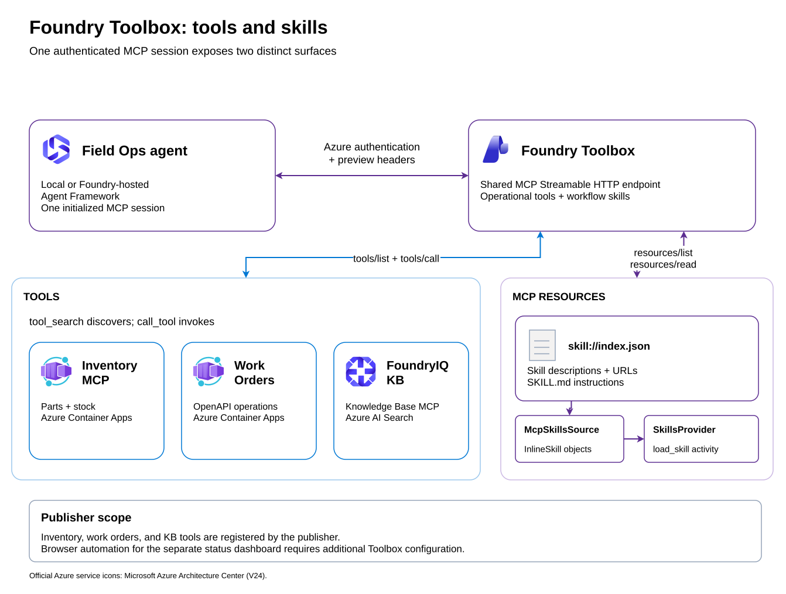

# Toolbox Integration

Fibey connects to the **Foundry Toolbox** through one **MCP (Model Context
Protocol) Streamable HTTP** endpoint. The Toolbox dispatches tool calls to
operational backends and serves versioned skills as MCP Resources.



[Editable Excalidraw source](images/toolbox-integration.excalidraw)
(open in [Excalidraw](https://aka.ms/excalidraw)).

The arrows show requests and responses on the same MCP session. The tools
surface provides `tool_search` and `call_tool` for inventory, Work Orders
OpenAPI, and FoundryIQ KB MCP. The resources surface provides the skill index
and `SKILL.md` content consumed by `McpSkillsSource` and `SkillsProvider`.

The status dashboard is deployed as a separate Container App, but the current
publisher does **not** register a browser automation tool. Status checks
through browser automation require that additional Toolbox configuration.

## MCP connection and authentication

Both modes use Agent Framework's `MCPStreamableHTTPTool` with an explicit
`httpx.AsyncClient`, `load_prompts=False`, and a 120-second HTTP timeout:

| Mode | Entrypoint | Authentication |
|------|------------|----------------|
| Local | `src/fibey/agent/agent.py` | `_ToolboxAuth`: Azure CLI credential, default credential fallback; optional `TOOLBOX_API_KEY` uses `_ToolboxApiKeyAuth` |
| Hosted | `src/fibey/agent/hosted.py` | `ToolboxAuth`: token provider backed by managed identity, with azd credential fallback for development |

Bearer tokens use `https://ai.azure.com/.default`. Custom `httpx.Auth` injects
authentication on **every request**, including the MCP initialize handshake.
Do not replace the explicit client with `FoundryChatClient.get_mcp_tool()`:
that path did not carry the Toolbox bearer token through initialization.

Each entrypoint adds `api-version=v1` to `TOOLBOX_MCP_URL` if absent and sends:

```http
Foundry-Features: Toolboxes=V1Preview,Skills=V1Preview
```

Use the bare provisioned Toolbox URL in configuration. The MCP API version is
`v1`, not a date-based version. Both preview feature flags must reach resource
requests as well as tool requests.

## Tools configured by the publisher

`scripts/setup-toolbox.sh` creates these definitions:

| Definition | Type | Backend |
|------------|------|---------|
| Tool Search | `toolbox_search_preview` | Toolbox built-in discovery |
| Inventory | `mcp` | `https://<inventory-fqdn>/mcp`, server label `inventory` |
| Work Orders | `openapi` | Deployed `/openapi.json` with the server URL injected; anonymous backend auth |
| Knowledge Base | `mcp` | AI Search KB `/mcp?api-version=2026-05-01-preview`, server label `knowledge_base` |

Tool search keeps the initial tool list small: `tool_search` discovers backend
operations and `call_tool` invokes them. Skills are resources, not additional
backend tool definitions.

The knowledge tool uses `project_connection_id=kb-fibey-field-ops-kb`.
Bicep creates that connection as `RemoteTool` with `ProjectManagedIdentity`,
the KB MCP endpoint as its target, and `https://search.azure.com/` as its
audience. The Foundry project and account identities receive Search Index Data
Reader. This is a KB MCP connection, not a `CognitiveSearch`/API-key
`azure_ai_search` tool.

### KB resource URI compatibility

The hosted entrypoint relaxes MCP SDK resource-content URI fields to
`str | None` and rebuilds the related models. This accommodates KB tool
responses containing `uri: null` or `uri: ""`, which otherwise fail `AnyUrl`
validation. The patch is hosted-only; it does not change the required skill
URLs validated by `McpSkillsSource`.

## Toolbox skills: MCP Resources (SEP-2640)

The git source of truth is `skills/<name>/SKILL.md`. The five skills are
`field-briefing`, `inventory-lookup`, `knowledge-retrieval`,
`work-order-management`, and `work-order-preparation`. Runtime instructions
come from the Toolbox:

1. `resources/list` discovers `skill://index.json`, following pagination.
2. `resources/read` reads that JSON index, including each skill's name,
   description, and URL.
3. `resources/read` fetches each referenced `SKILL.md` as text.
4. `McpSkillsSource` converts the entries into `InlineSkill` objects for
   `SkillsProvider`.

**Python framework gap:** this repository pins Agent Framework 1.5.0, whose
Python skills support has no native MCP source. C# has `UseMcpSkills`; Fibey's
`src/fibey/agent/mcp_skills.py` implements Python's pluggable `SkillsSource`
interface instead.

Both modes use `SkillsProvider(McpSkillsSource(tool.session))` on the same
initialized MCP session used for tool calls. The provider advertises skill
descriptions and retains the **`load_skill`** tool, so the activity sidebar
still shows which workflow is loaded.

Hosted startup eagerly loads the resources before starting `ResponsesHostServer`.
Local mode loads them through the provider when the agent runs. The source
caches skills for its lifetime: hosted content stays cached until restart;
local runs create a new source.

### Failure behavior

With `TOOLBOX_MCP_URL` configured, MCP list/read failures, invalid index JSON,
skill resources without the required index, and empty/non-text skill bodies
propagate as errors. Hosted initialization fails rather than serving with
broken skills; local requests surface errors through the gateway stream.

No skill resources, or an empty index, produces a warning and no skill tools.
An unset Toolbox URL also warns and provides no Toolbox skills. Local mode
can still use its separately configured direct knowledge-search fallback.

## Publish workflow

The `azure.yaml` **postdeploy** hook runs `scripts/setup-toolbox.sh` after
backend deployment. It uses Foundry REST with Azure CLI tokens, `curl`, and
Python 3; there is no `azd ai` publishing dependency.

| Change | Publisher behavior |
|--------|--------------------|
| Nothing changed | Compare default skill content and attachment names; no new versions |
| Skill content changed | Upload via `POST /skills/{name}/versions?api-version=v1` with `Skills=V1Preview`; promote the skill's `default_version` |
| Skill attachment names changed | Publish a new Toolbox version with existing `tools` and new `skills`; promote the Toolbox's `default_version` |
| Tool definitions changed | With `FORCE_TOOLBOX_UPDATE=1`, rebuild backend definitions and publish a new default Toolbox version |

Toolbox versions are immutable, so every new version repeats its tool list.
Skill references are unpinned:

```json
{
  "skills": [
    {"type": "skill_reference", "name": "field-briefing"}
  ]
}
```

Each reference resolves the skill's default version. Publishing changed skill
content does not require a new Toolbox version or agent-image change, but an
already-running hosted source must be restarted to refresh its cache:

```bash
# Publish content/attachment changes, even if the Toolbox already exists
./scripts/setup-toolbox.sh

# Refresh hosted tools and skill resources
azd deploy fibey-agent
```

For changed backend URLs or OpenAPI definitions, use
`FORCE_TOOLBOX_UPDATE=1 ./scripts/setup-toolbox.sh` before redeploying the agent.

## Preview caveats and code pointers

Toolboxes and skills require `Toolboxes=V1Preview` and `Skills=V1Preview`;
KB MCP uses `2026-05-01-preview`. These preview contracts and hosted-agent
regional availability may change. See [deployment.md](deployment.md) for the
hosted flow, RBAC, and deployment verification limits.

| File | Purpose |
|------|---------|
| `src/fibey/agent/agent.py` | Local agent, Toolbox authentication, skills provider |
| `src/fibey/agent/hosted.py` | Hosted Responses server, authentication, KB URI workaround |
| `src/fibey/agent/mcp_skills.py` | MCP Resources-to-SkillsSource adapter |
| `skills/` | Version-controlled publishing source |
| `scripts/setup-toolbox.sh` | Skill and Toolbox version publication |
| `agent.yaml` / `azure.yaml` | Hosted definition and azd deployment/hooks |
| `tests/test_mcp_skills.py` | Resource discovery, loading, warnings, and error cases |
